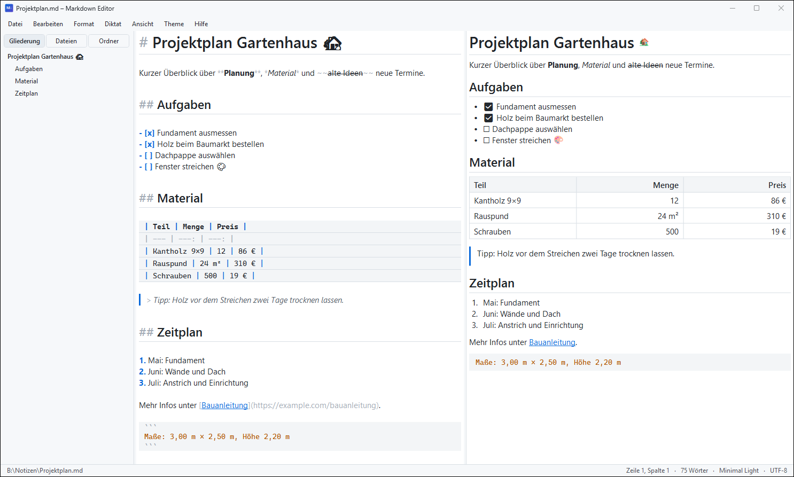
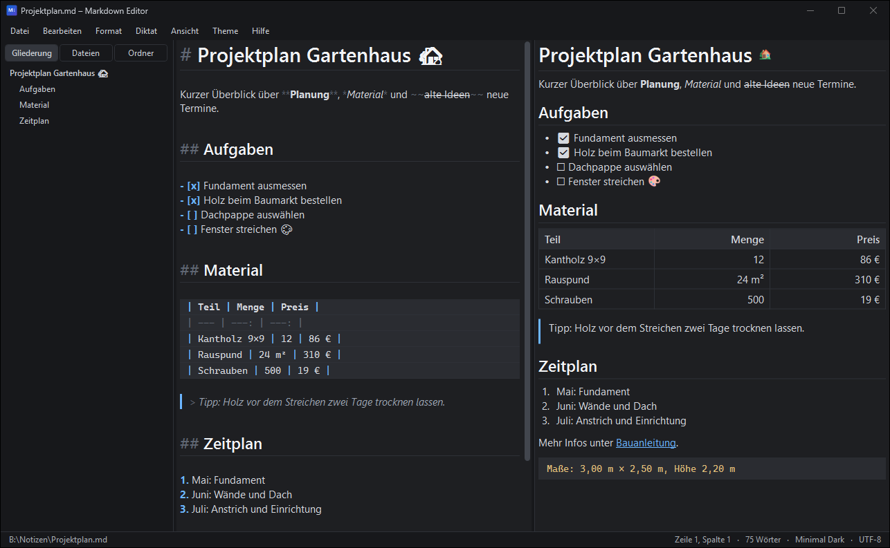

# Markdown Editor

Schlanker Markdown-Editor für Windows (C# / WPF, eine EXE von ca. 6,6 MB, davon 6,4 MB Emoji-Grafiken).
Links steht das Markdown, rechts die formatierte Vorschau. **Beide Seiten sind bearbeitbar**, und jede Änderung
wird automatisch in die andere Seite übertragen. Gespeichert wird **immer reines Markdown**.



Dasselbe Beispiel im Theme „Minimal Dark“:



## Funktionen

| Bereich | Umfang |
| --- | --- |
| Markdown-Editor | Live-Formatierung pro Zeile, Markierungen bleiben sichtbar (gedimmt), Zoom, Suche, textbasiertes Undo/Redo, Einfügen immer als reiner Text. **Enter** fügt einen Markdown-Zeilenumbruch ein (zwei Leerzeichen am Zeilenende, dezent markiert), damit der folgende Text auch in der Vorschau in einer neuen Zeile beginnt |
| Vorschau (bearbeitbar) | Tippen, Löschen, Fett/Kursiv/Unterstrichen/Durchgestrichen/Code, Überschriften, Links und Emojis direkt in der formatierten Ansicht; Tabellenzellen und Listenpunkte sind editierbar, Aufgaben lassen sich per Klick auf ☐ abhaken. Strukturbefehle (Tabelle, Trennlinie, Listen, Zitat, Codeblock) laufen über das Markdown und gelten für den Block am Cursor |
| Synchronisation | Cursor in einem Feld → die passende Stelle wird im anderen angezeigt. Unbearbeitete Blöcke behalten ihren exakten Original-Markdown-Text |
| Rechtsklick / Format-Menü | in beiden Feldern, in Gruppen: **Schrift** (Fett, Kursiv, Unterstrichen `__Text__`, Durchgestrichen, Inline-Code, Formatierung entfernen), **Textebene** (Standardtext, Überschrift 1–6, Zitat, Codeblock), **Listen** (Aufzählung, Nummerierung, Aufgabenliste, Aufgabe erledigt, Ein-/Ausrücken), **Hinzufügen** (Link, Bild, Emoji, Trennlinie, Tabelle). Häkchen zeigen die Absatzart am Cursor; auf Links: **Link öffnen / bearbeiten / entfernen**; in Tabellen: **Tabelle** (Zeile oberhalb/unterhalb einfügen, Zeile löschen, Spalte links/rechts einfügen, Spalte löschen, Tabelle bearbeiten…); Rechtschreibvorschläge |
| Emojis | Vollständige Unicode-Auswahl (1.923 Emojis) in den Kategorien der Apple-Tastatur, Suche auf Deutsch/Englisch, „Häufig verwendet“, farbige Vorschau. In der Datei steht das Unicode-Zeichen (auf iPhone/Mac also in Apple-Optik) |
| Tabellen | Visueller Tabellen-Editor (Zeilen/Spalten, Ausrichtung). Gespeichert wird `Spalte 1 \| Spalte 2` / `--- \| ---` als ausgerichteter Fließtext. Zeilen und Spalten lassen sich auch per Rechtsklick in der Zelle einfügen/löschen |
| Bilder | **Strg+V** mit einem Screenshot speichert ihn als PNG in `bilder/` neben der Notiz und verlinkt ihn (ungespeicherte Notiz wird vorher gespeichert); im Explorer kopierte oder per Drag & Drop abgelegte Bilddateien werden an der Cursor- bzw. Ablagestelle verlinkt, andere Dateien wie bisher geöffnet. Pfade relativ zur Notiz |
| Dateien | Seitenleiste **„Dateien“**: alle mit dem Programm erstellten, geöffneten oder gespeicherten Dateien (Ablageort wird gemerkt, Filter, Rechtsklick: Öffnen / Im Explorer anzeigen / Aus Liste entfernen). Dateien, die am gespeicherten Ort nicht mehr existieren, werden beim Start, beim Anzeigen der Liste und beim Öffnen automatisch entfernt. Außerdem: „Ordner“-Ansicht, Neu, Öffnen, Speichern, Speichern unter, Drag & Drop, Auto-Save, atomares Speichern |
| Ansicht | Seitenleiste (F9) mit Gliederung / Dateien / Ordner; **Markdown und Vorschau** (Strg+Umschalt+1), **nur Markdown** (Strg+Umschalt+2), **nur Vorschau** (Strg+Umschalt+3), F12 wechselt reihum; Vollbild (F11, Esc beendet) |
| Themes | Minimal Light, Minimal Dark, Solarized Light/Dark, Monokai, Nord, Sepia; Umschalten live ohne Neustart; Dark/Light per Strg+Umschalt+D |

Wichtige Tastenkürzel: Strg+B/I/U (Fett/Kursiv/Unterstrichen), Strg+1…6/0 (Überschriften/Standardtext), Strg+Leertaste (Formatierung entfernen), Strg+Enter (Aufgabe abhaken), Strg+T (Tabelle),
Strg+K (Link), Strg+Umschalt+I (Bild), **Strg+Umschalt+E (Emoji)**, Strg+Klick (Link in der Vorschau öffnen). Alle weiteren stehen unter *Hilfe → Tastenkürzel*.

## Build

**Ohne Installation** (nutzt `csc.exe` aus dem in Windows enthaltenen .NET Framework 4.8):

```powershell
powershell -ExecutionPolicy Bypass -File .\build.ps1        # erzeugt bin\MarkdownEditor.exe
powershell -ExecutionPolicy Bypass -File .\build.ps1 -Run   # bauen und starten
```

`assets\emoji.dat` liegt fertig bei. Neu erzeugen musst du sie nur bei einem Unicode-Update (lädt die Quellen einmalig aus dem Netz):
`powershell -ExecutionPolicy Bypass -File .\tools\build-emoji-assets.ps1`

**Mit .NET SDK / Visual Studio** (optional): `dotnet build -f net48` oder für .NET 8
`dotnet publish -c Release -f net8.0-windows -r win-x64 -p:PublishSingleFile=true`.
Der Code ist bewusst C#-5-kompatibel, damit beide Wege funktionieren.

**Selbsttest:** `MarkdownEditor.exe --selftest ergebnis.txt datei.md` spielt Bearbeitungen in Vorschau und Markdown durch
(unsichtbar, ohne echte Eingaben, ohne Einstellungen zu ändern) und schreibt die Ergebnisse in `ergebnis.txt`.

Die EXE ist portabel. Einstellungen und Dateiliste liegen unter `%APPDATA%\MarkdownEditor\settings.ini`.
Mit der Umgebungsvariable `MDEDITOR_DATEN=<ordner>` nimmt das Programm stattdessen `<ordner>\settings.ini`,
z. B. für Screenshots mit Beispieldateien statt der eigenen Dateiliste.

**Updates:** Beim Start (abschaltbar unter *Hilfe → Beim Start nach Updates suchen*) und über *Hilfe → Nach Updates suchen…* fragt
der Editor das neueste [GitHub-Release](https://github.com/christianngl/markdown-editor/releases) ab. Ist es neuer als die eigene Version,
zeigt er die Änderungen und tauscht auf Wunsch die EXE aus (die alte bleibt als `MarkdownEditor.exe.old` liegen) und startet neu.
Weil das Repo privat ist, nutzt er das Token der angemeldeten GitHub-CLI (`gh auth login`) oder `GH_TOKEN`/`GITHUB_TOKEN`.
Die eigene Version übernimmt `build.ps1` aus dem neuesten Versionsabschnitt in `CHANGELOG.md`.

**Als Standard-App für Textformate** (`.md`, `.markdown`, `.mdown`, `.mkd`, `.mkdn`, `.txt`; pro Gerät einmal, auch nach einem Umzug des Ordners):
`powershell -ExecutionPolicy Bypass -File .\tools\register-file-types.ps1`. Das Skript registriert `bin\MarkdownEditor.exe`
für den aktuellen Benutzer und entfernt Einträge alter Versionen, deren EXE nicht mehr existiert. Diese erscheinen sonst als
defekte Doppel im „Öffnen mit“-Dialog. Anschließend öffnet sich *Einstellungen → Standard-Apps → Markdown Editor*. Dort einmal
„Als Standard festlegen“ klicken, denn die Standard-App kann unter Windows nur der Benutzer selbst setzen.

## Diktat (offline)

Notizen lassen sich per Sprache eingeben. Die Spracherkennung läuft **vollständig lokal** mit
[whisper.cpp](https://github.com/ggml-org/whisper.cpp) (Open Source, MIT-Lizenz). Es wird kein Online-Dienst verwendet,
und das Audio verlässt den Rechner nicht.

- **Einrichten (einmalig):** `powershell -ExecutionPolicy Bypass -File .\tools\setup-whisper.ps1`
  - Das Skript lädt `whisper-cli.exe` mit den DLLs nach `bin\whisper\` und das Modell `ggml-base.bin` (~150 MB) nach `bin\whisper\models\`.
  - Ein genaueres Modell gibt es mit `-Model small` (~470 MB).
  - Für Rechner ohne Internet: den Ordner `whisper\` einfach neben die EXE kopieren.
- **Bedienung:** **Strg+Umschalt+M** startet die Aufnahme. Ein zweites Strg+Umschalt+M beendet sie, und der erkannte Text wird am Cursor eingefügt.
  - Das Einfügen ist ein einzelner Undo-Schritt.
  - **Esc** verwirft die Aufnahme bzw. bricht die Transkription ab.
  - Eine Aufnahme dauert höchstens 10 Minuten.
  - Die Statusleiste zeigt Aufnahmedauer und Pegel.
- **Sprachbefehle** (abschaltbar):
  - „neue Zeile“
  - „neuer Absatz“
  - „Aufzählungspunkt“ (`- `)
  - „neue Aufgabe“ oder „Checkbox“ (`- [ ] `)
  - „neue Überschrift“ (`## `)
- **Einstellungen:** unter *Diktat → Mikrofon / Modell / Sprache…*. Wählbar sind das Mikrofon, das Modell und die Sprache (Deutsch, Englisch oder automatisch).
- **Mikrofon gesperrt?** Unter Windows-Einstellungen → Datenschutz und Sicherheit → Mikrofon den Schalter „Desktop-Apps den Zugriff auf das Mikrofon erlauben“ einschalten.
- **Technik:**
  - `Services/AudioRecorder.cs` nimmt per `winmm.dll` (P/Invoke) mit 16 kHz mono auf.
  - `Services/WhisperTranscriber.cs` ruft `whisper-cli.exe` auf.
  - `Services/DictationPostProcessor.cs` entfernt Artefakte wie `[BLANK_AUDIO]` und setzt die Sprachbefehle um.
  - `MainWindow.Dictation.cs` enthält die Befehle.
  - Temporäre WAV-Dateien in `%TEMP%\MarkdownEditor` werden sofort gelöscht.

## Projektstruktur

```
MarkdownEditor/
├─ build.ps1                    Build ohne SDK (csc.exe), bettet assets/emoji.dat ein
├─ MarkdownEditor.csproj        optionaler SDK-Build (net48 / net8.0-windows)
├─ app.manifest                 Per-Monitor-DPI, Windows-10/11-Kompatibilität
├─ assets/
│  ├─ app.ico                   von tools/make-icon.ps1
│  └─ emoji.dat                 Emoji-Daten + Bilder, von tools/build-emoji-assets.ps1
├─ tools/                       make-icon.ps1, build-emoji-assets.ps1, setup-whisper.ps1 (Diktat einrichten)
└─ src/
   ├─ Program.cs                Einstiegspunkt, globale Fehlerbehandlung, --selftest
   ├─ MainWindow.cs             Layout, Menüs, Befehle (Routing ins aktive Feld), Dateien, Seitenleiste, Sync Markdown ↔ Vorschau
   ├─ MainWindow.Dictation.cs   Diktat: Aufnahme, lokale Transkription (whisper.cpp), Einfügen am Cursor
   ├─ MainWindow.Update.cs      Update-Suche beim Start und im Hilfe-Menü
   ├─ SelfTest.cs               interner Selbsttest
   ├─ Editor/
   │  ├─ MarkdownEditorBox.cs   Markdown-Editor: Zeilenmodell, Live-Formatierung, Undo/Redo, Enter/Tab, Suche, ApplyExternalText
   │  ├─ PreviewEditorBox.cs    bearbeitbare Vorschau: Eingabe, Formatierungen, Emoji/Link einfügen
   │  ├─ Formatter.cs           Formatierungsaktionen im Markdown (fügen nur Markdown-Syntax ein / entfernen sie)
   │  └─ EmojiCatalog.cs        lädt emoji.dat, Kategorien, Suche, Emoji-Erkennung im Text
   ├─ Markdown/
   │  ├─ MarkdownSyntax.cs      Zeilenklassifizierung + Inline-Tokenizer
   │  ├─ MarkdownTable.cs       Tabellenmodell: parsen und ausgerichtet schreiben
   │  ├─ PreviewRenderer.cs     Markdown → bearbeitbares FlowDocument (mit Block↔Zeilen-Verknüpfung)
   │  ├─ MarkdownSerializer.cs  FlowDocument → Markdown; Assemble() schreibt nur geänderte Blöcke neu
   │  └─ PreviewModel.cs        BlockInfo, InlineTag, PreviewStyle, RenderResult
   ├─ Dialogs/                  TableDialog, EmojiPicker, InputDialog, DictationSettingsDialog
   ├─ Themes/                   Theme/ThemeCatalog, ThemeManager, Styles (XAML)
   └─ Services/                 AppSettings (inkl. Dateiliste), DocumentFile, AudioRecorder,
                                WhisperTranscriber, DictationPostProcessor, UpdateService (GitHub-Releases)
```

## Architektur in Kürze

- **Markdown-Editor:** Jede Textzeile ist genau ein `Paragraph`. Alle Bearbeitungen laufen über `Replace(start, end, text)`
  (ein Undo-Schritt). Neu aufgebaut werden nur Zeilen, deren Text oder Typ sich geändert hat.
- **Vorschau → Markdown:** `PreviewRenderer` verknüpft jeden Vorschau-Block mit seinen Quellzeilen und merkt sich dessen
  Serialisierung (`Baseline`). Nach einer Bearbeitung (250 ms Pause) serialisiert `MarkdownSerializer.Assemble` alle Blöcke.
  Unveränderte Blöcke übernehmen ihre Originalzeilen samt Abständen, nur geänderte werden neu geschrieben.
  `ApplyExternalText` ersetzt im Editor nur den geänderten Zeilenbereich, daher ist eine Vorschau-Änderung im Markdown mit Strg+Z rückgängig zu machen.
- **Markdown → Vorschau:** Nach direkten Änderungen im Markdown wird die Vorschau neu gerendert (Scrollposition bleibt).
  Nach Bearbeitung in der Vorschau wird sie neu aufgebaut, sobald du wieder ins Markdown wechselst.
- **Emojis:** `emoji.dat` enthält Unicode-Sequenz, Apple-Kategorie, deutschen Namen und Suchbegriffe (Unicode CLDR) sowie ein 48-px-PNG.
  In der Vorschau werden Emojis als Bild angezeigt und als Unicode-Zeichen zurückgeschrieben.

## Erweitern

- **Neues Theme:** eine Zeile in `ThemeCatalog.All` (`Themes/Theme.cs`).
- **Neue Formatierung:** Methode in `Formatter.cs` (Markdown) und optional in `PreviewEditorBox` (Vorschau), dann in
  `MainWindow.InitCommands` mit `Fmt("Name", Modifier, Taste, Formatter.MeineAktion, pv => pv.MeineAktion())` registrieren und in
  `AddFormatItems` einhängen. Ohne Vorschau-Variante (`null`) läuft der Befehl in der Vorschau automatisch über den Markdown-Editor.
- **Neue Syntax:** `LineKind`/`InlineStyle` in `MarkdownSyntax.cs`, Darstellung in `MarkdownEditorBox.BuildParagraph` und
  `PreviewRenderer`, Rückübersetzung in `MarkdownSerializer`.
- **Plugin-Idee:** Interface `IEditorCommand` und DLLs aus einem `plugins`-Ordner per Reflection laden. Die Befehlsregistrierung ist zentralisiert.

## Hinweise

- `__Text__` wird wie gewünscht als **unterstrichen** dargestellt. In Standard-Markdown (GitHub, CommonMark) bedeutet `__Text__` allerdings *fett*.
- **Emoji-Optik:** Apples Emoji-Grafiken sind urheberrechtlich geschützt und dürfen nicht mitgeliefert werden. Die farbige Darstellung
  nutzt deshalb **Microsoft Fluent Emoji 3D** (MIT-Lizenz) und für Flaggen u. a. **Twemoji** (CC-BY 4.0, © Twitter/X und Mitwirkende).
  Auf Apple-Geräten erscheinen die gespeicherten Zeichen in Apple-Optik. Im Markdown-Feld bleiben Emojis einfarbig (Textmodell);
  11 sehr neue Emojis ohne Grafik sind im Picker ausgeblendet.
- Wird in der Vorschau ein Block bearbeitet, schreibt das Programm ihn in normalisierter Form neu, z. B. mit Leerzeile zum Nachbarblock
  oder `\*` für ein wörtliches Sternchen. Alle anderen Blöcke bleiben Zeichen für Zeichen erhalten.
- Sehr große Dateien (> 10.000 Zeilen) funktionieren, das Neuformatieren pro Tastendruck wird dort aber spürbar.

## Ideen für weitere Features

1. Suchen & Ersetzen (inkl. Regex)
2. Mehrere Dokumente in Tabs
3. Export nach HTML/PDF
4. Erkennen externer Dateiänderungen (FileSystemWatcher)
5. Wiederherstellung nach Absturz (periodischer Snapshot)
6. Eigene Themes als JSON-Datei laden
